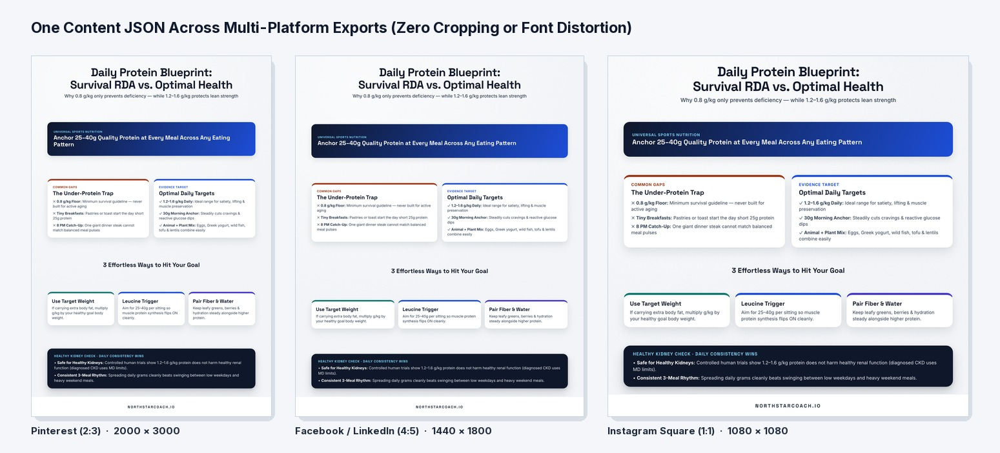
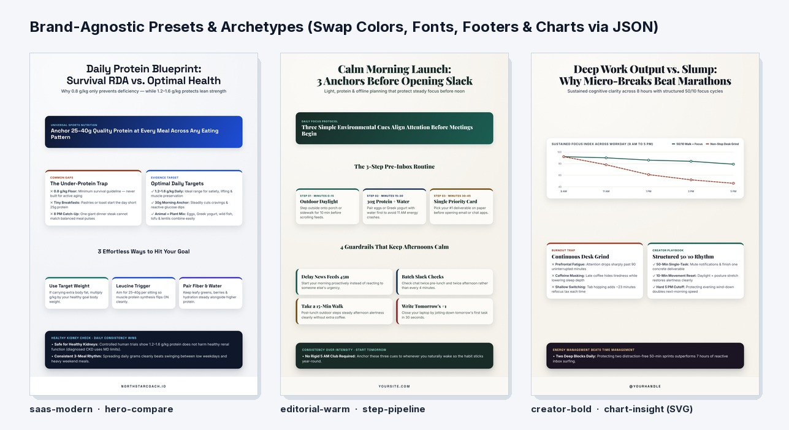
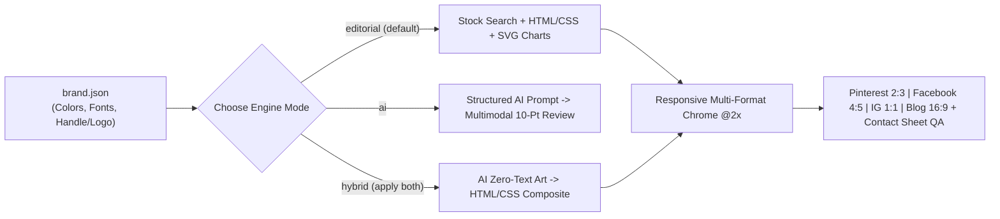

# Brand Infographics Skill (`--engine editorial | ai | hybrid`)

A universal, brand-agnostic **Agent Skill** for producing crisp, multi-platform infographics for **any brand, website, newsletter, or social account** across **Pinterest (`2:3`), Facebook & Instagram Portrait (`4:5`), Instagram Square & LinkedIn (`1:1`), Stories/Reels (`9:16`), and Blogs/OG Cards (`16:9`)**.



---

## Why This Skill Outperforms Standard AI Image-Gen Skills

Standard "generate infographic" skills rely purely on text-to-image diffusion prompts. When you actually run them across real brand & marketing batches, four predictable bottlenecks appear — and this skill solves every one of them:

| Challenge | Normal AI-Only Infographic Skills | `brand-infographics` (`editorial \| ai \| hybrid`) |
|---|---|---|
| **Small Text & Tables** | Warped glyphs, typos, and blurry subscripts inside dense comparison cards | **100% vector browser typography (`@2x` HiDPI)** in `editorial` and `hybrid` modes — zero spelling errors |
| **Brand Consistency** | Palette drifts between runs; footer URL/logo morphs or misaligns | **Declarative `brand.json`** locks ground/surface/ink/accent hex tokens, fonts, footer handle/URL, and logo across batches |
| **Contrast & Accessibility** | Neon pills or thin light text fail readability on mobile screens | **Built-in `contrast_audit.py`** validates WCAG 2.1 (`>= 4.5:1`) and **APCA perceptual contrast (`\|Lc\| >= 75`)** before rendering |
| **Multi-Platform Resizing** | Cropping `2:3` Pinterest pins to `4:5` Facebook chops footers or shrinks text inside wide margins | **Responsive flex-column templates** re-flow the exact same JSON spec natively across `2:3`, `4:5`, `1:1`, `9:16`, and `16:9` |
| **Visual Richness vs. Precision** | Pure code can feel stark; pure AI muddies dense labels | **`--engine hybrid`** lets AI generate **zero-text bespoke art/textures** (or fetch stock photos) and composites HTML/CSS typography cleanly over the frame |



---

## Architecture & Engine Modes (`--engine editorial | ai | hybrid`)



| Engine Mode | When to Pick It | How It Works |
|---|---|---|
| **`editorial`** *(default)* | Text-dense social pins, comparisons, numbered protocols, checklists, SaaS feature breakdowns, CSV batch runs | Stock photo (`stock_search.py`) + responsive HTML/CSS archetypes + inline SVG charts + Chrome `@2x` + Pillow export |
| **`ai`** | Illustrated visual metaphors, hand-drawn concept scenes, creative posters, fast 1-off social visuals | Structured prompt builder (`ai_prompt.py --engine ai`) → native image subagent or Gemini Image API → 10-point multimodal quality rubric loop |
| **`hybrid`** *(apply both!)* | Flagship educational pillars needing **bespoke art/anatomical visuals** *plus* **razor-sharp multi-platform copy & consistent brand footer** | `ai_prompt.py --engine hybrid` generates **zero-text illustration** matched to your `brand.json` surface hex → composited directly into an HTML/CSS archetype → rendered across all social sizes |

---

## Complete Walkthrough: From Zero to Multi-Platform Batch

### Step 1 — Set Up Environment & Browser Prerequisites
1. Install Python dependencies (`pillow` powers cross-platform PNG/JPEG export and contact sheets — no macOS-only tools required):
   ```bash
   pip install pillow
   ```
2. Ensure **Google Chrome**, **Chromium**, or **Microsoft Edge** is installed (`scripts/render.py` auto-detects the binary across macOS, Linux, and Windows, or set `CHROME_BIN`).
3. Copy `.env.example` → `.env` (or export environment variables) for any external APIs you plan to use:
   - `PEXELS_API_KEY` / `PIXABAY_API_KEY` / `UNSPLASH_ACCESS_KEY` for `scripts/stock_search.py`.
   - `GEMINI_API_KEY` or `OPENROUTER_API_KEY` (only needed when running `--engine ai` standalone via CLI outside an agent with native image tools).

---

### Step 2 — Onboard Your Brand (`brand.json`) & Audit Contrast
Pick one of the 4 starter presets in `presets/brands/` (`editorial-warm`, `saas-modern`, `creator-bold`, `clinical-clean`) **or** generate a custom `brand.json` for any site or social handle:

```bash
python3 scripts/brand_init.py \
  --name "Northstar Coaching" \
  --footer "NORTHSTARCOACH.IO" \
  --preset saas-modern \
  --accent "#0F766E" \
  --logo path/to/logo.png \
  -o my-brand.json
```

Validate every foreground/background pair with the bundled offline WCAG + APCA contrast auditor:
```bash
python3 scripts/contrast_audit.py --brand my-brand.json
```
Example output:
```text
Pair                               FG        BG           WCAG   APCA Lc  Status
----------------------------------------------------------------------------------
Headline on Ground                 #0F172A   #F3F5F8    16.35:1     98.5  PASS
Body on Card                       #334155   #FFFFFF    10.35:1     94.0  PASS
Banner Kicker on Dark Banner       #7DD3FC   #0F172A    10.71:1    -72.6  PASS
White Text on Accent #1 Pill       #FFFFFF   #1D4ED8     6.70:1    -87.2  PASS
```

---

### Step 3 — Prepare Content & Toggle Engines

- **Option A — `editorial` (HTML/CSS + Stock Photo / SVG Chart)**:
  Create a lightweight JSON spec (`examples/sample_infographic.json`) and optionally fetch clean stock photography:
  ```bash
  python3 scripts/stock_search.py "meal prep salmon bowl" \
    --source pexels --orientation portrait --count 3 --download assets/stock/
  ```
- **Option B — `ai` (Generative AI Infographic + Rubric)**:
  ```bash
  python3 scripts/ai_prompt.py "Why Sleep Beats Extra Caffeine" \
    --brand my-brand.json --engine ai --type comparison --format facebook --build-prompt
  ```
- **Option C — `hybrid` (Apply Both: AI Art + HTML Typography)**:
  1. Generate a zero-text illustration matched seamlessly to your card color:
     ```bash
     python3 scripts/ai_prompt.py "Minimal botanical sleep chamomile illustration" \
       --brand my-brand.json --engine hybrid --build-prompt
     ```
  2. Set `"media_path"` in your infographic JSON to that saved image path, then render cleanly across every social size in Step 4!

---

### Step 4 — Render Across Every Social Platform at Once
One command exports your JSON spec (or a whole directory of `.json` specs) into **Pinterest (`2:3`)**, **Facebook (`4:5`)**, **Instagram Square (`1:1`)**, and more:

```bash
python3 scripts/render.py \
  --input examples/sample_infographic.json \
  --brand my-brand.json \
  --formats pinterest facebook ig-square \
  --out dist/
```

Outputs are organized neatly by platform and format (`dist/<platform>/{html,png,jpg}/`).

---

### Step 5 — Visual QA Contact Sheet
Build labeled multi-pin QA contact sheets across any output directory before publishing:
```bash
python3 scripts/make_contact_sheet.py --input dist/facebook/jpg --out dist/qa_facebook_sheet.jpg
```

---

## Repository Layout
- [`SKILL.md`](./SKILL.md) — Agent execution manual (`editorial | ai | hybrid` workflows, guardrails, QA rubric)
- [`presets/brands/`](./presets/brands/) — Ready-to-use brand themes (`editorial-warm.json`, `saas-modern.json`, `creator-bold.json`, `clinical-clean.json`)
- [`references/`](./references/) — Brand schema, social aspect-ratio guide, OKLCH/APCA color rules, archetype specs
- [`scripts/`](./scripts/) — `brand_init.py`, `contrast_audit.py`, `stock_search.py`, `render.py`, `ai_prompt.py`, `make_contact_sheet.py`
- [`docs/images/`](./docs/images/) — Showcase visuals rendered directly by `render.py`
- [`examples/`](./examples/) — Sample single-spec JSON starter

## License
MIT — free to adapt, extend, and publish for any personal or commercial brand.
